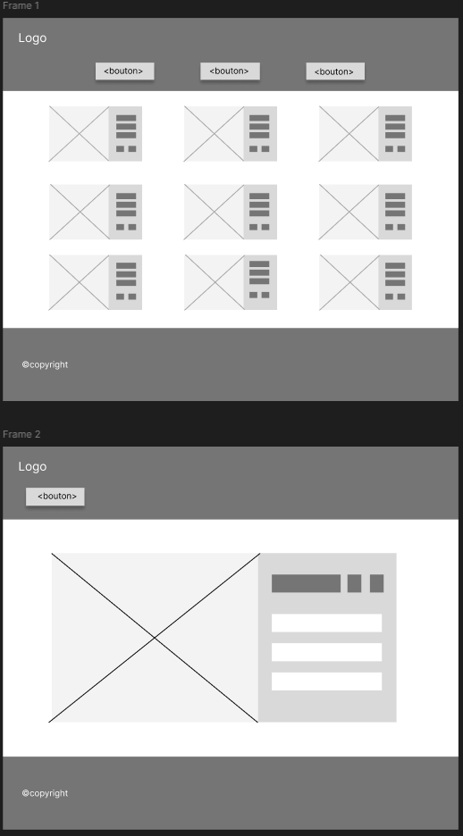
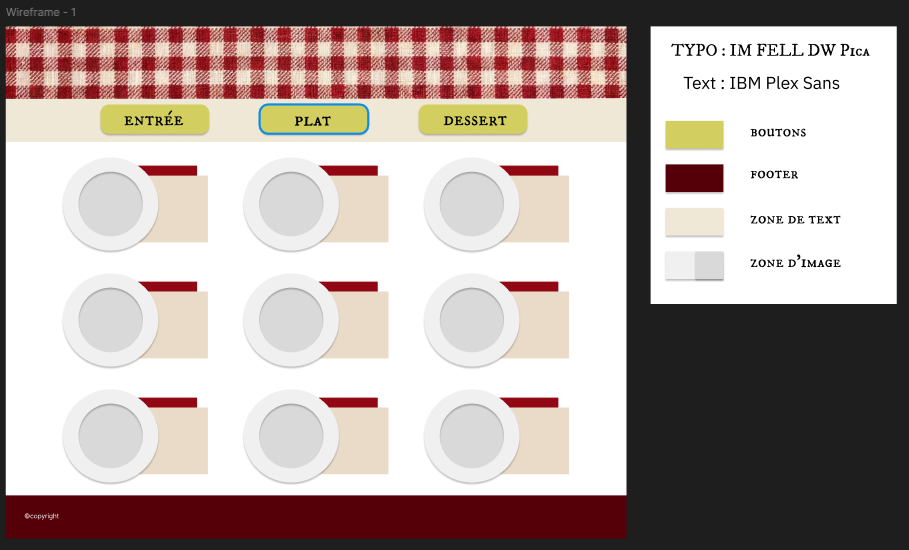

## Creation d'un projet frontend

-npm create vite@latest projet-fullstack
-npm i
-je clean mon dossier pour partir d'une base vierge.
-npm run dev et l'inspecteur si tout est bien viable.

## Creation d'un projet backend

-git clone monprojet backend
(appartir de la c'est un peu brouillon dans tete)

-j'ai ajouter un .env et vérifier si tout tournait bien.

(je savais plus alors j'ai fais un `git remove remote origin` car mon dossier backend apparaissait comme un dossier deja enregistrer sur github)

-j'ai commencer mon read.md -`git remote add origin git@github.com:Laurie-dev-web/Fullstack.git`
-git status
-git add . (ou backend/ frontend/ readme.md)
-git commit -m ""
-git push -u origin

## MON PROJET :

Une roulette aleatoire qui donne un plat avec la recette.
(entrée, plat, dessert)

l'entrée, plat, dessert seront des catégories cliquable.

exemple: je coche la case plat, la roue tourne et me donne un plat et sa recette.


**Premier wireframes/schéma de mon projet**

Mon projet est accepté sans roulette, donc je suis venu faire quelque chose de plus sobre:

    -Un bouton par catégories.
    -Une carte de présentation en une photo, titre du repas et une petite description.
    -Carte cliquable qui nous amène sur la recette.
        -Un bouton pour revenir sur la home page.



Je profite de faire une maquette de la home page et y mettre les éléments de couleurs, de typographie et de valeurs.



## initialisation de ma BDD

SQLelectron
creation database et d'une table.

`create table log (
id integer not null generated always as identity primary key,
title TEXT not null,
video_game TEXT not null,
type_plat TEXT not null, 
);`

`insert into log(title, video_game, type_plat) VALUES ('Gateau au chocolat','Portal','Dessert');`

## lier le backend a la BDD

Ne pas oublier de faire une branche dev.

->npm i pg (librairie => package)

->npm i --save...ect

index.ts importer la BDD

## Ajouter de la donnée dans ma BDD

(fait avec claude)

````ALTER TABLE log
ADD COLUMN description TEXT,
ADD COLUMN portions_par_personne SMALLINT;```


```UPDATE log
SET description = 'Le fameux gâteau Forêt-Noire garni de crème chantilly, de copeaux de chocolat et de cerises confites (« The cake is a lie »).',
portions_par_personne = 1
WHERE title = 'Gateau au chocolat' AND video_game = 'Portal';```

INSERT INTO log (title, video_game, type_plat, description, portions_par_personne) VALUES
````

les valeurs fictifs sur les plats était trop bas alors j'ai utiliser un dé pour choisir entre 2 et 6.

```
UPDATE log
SET portions_par_personne = floor(random() * 6 + 2)::SMALLINT
WHERE type_plat = 'Plats';
```

## frontend appel ma bdd

## [backend] une nouvelle route GET/recettes/:id

J'ai modifier le nom de mon log = recette

## [frontend]

    -react-router
    -main.tsx: BrowserRouter
    -App.tsx: Routes

Dans React, key est une prop spéciale réservée qui permet d'identifier de manière unique chaque élément d'une liste, tandis que toutes les autres props classiques (comme className, id, ou des attributs data-\*) sont transmises normalement à la balise HTML <article>.

    Donc ici ma difficulté est que je n'avais pas encore compris que la key devait ce mettre dans mon <article>, parce dans mon erreurde l'inspecteur il disait que chaque enfant devait recevoir une key unique. et mon deuxieme point était que j'avais une return après l'opérateur de la fonction fléchée.

```
  return (
    <>
      <h1>pixel&poêle</h1>
      {recettes.map((recette) => (
        <article key={recette.id}>
          <h2>{recette.title}</h2>
          <p>{recette.video_game}</p>
          <p>{recette.description}</p>
        </article>
      ))}
    </>
  );
```

**lien dynamique Home->Log**

J'ai eu une erreur coté backend sur l'inspecteur du navigateur, et j'ai pris pas mal de temps a comprendre que c'était le fait que j'avais mis des guillemets au lieu de backtick dans URL de mon LogPage.tsx.

**Header omnipresent avec lien ->Home**

Création d'un composant Header qui return vers la HomePage.
