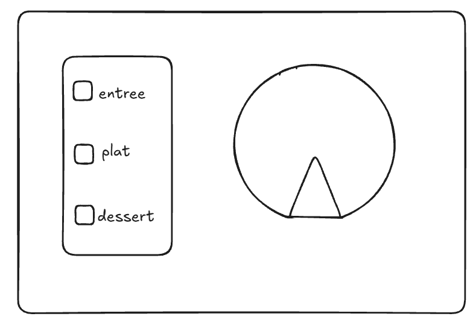

## Creation d'un projet frontend

-npm create vite@latest projet-fullstack
-npm i
-je clean mon dossier pour partir d'une base vierge.
-npm run dev et l'inspecteur si tout est bien viable.

## Creation d'un projet backend

-git clone monprojet backend
(appartir de la c'est un peu brouillon dans tete)

-j'ai ajouter un .env et vérifier si tout tournait bien.

(je savais plus alors j'ai fais un `git remove remote origin` car mon dossier backend apparaissait comme un dossier deja enregistrer sur github)

-j'ai commencer mon read.md -`git remote add origin git@github.com:Laurie-dev-web/Fullstack.git`
-git status
-git add . (ou backend/ frontend/ readme.md)
-git commit -m ""
-git push -u origin

## MON PROJET :

Une roulette aleatoire qui donne un plat avec la recette.
(entrée, plat, dessert)

l'entrée, plat, dessert seront des catégories cliquable.

exemple: je coche la case plat, la roue tourne et me donne un plat et sa recette.

